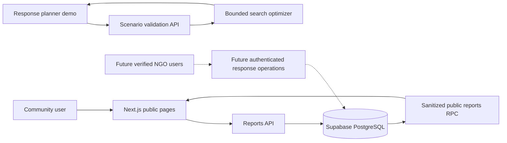

# AquaLink — architecture v0.1

## Boundaries

- **Public client**: Next.js pages (`/`, `/report`, `/map`). Anonymous reports are submitted via `/api/reports`; only verified/assigned/resolved reports are returned through a sanitized database RPC. No precise household locations or reporter identities are public.
- **Response simulator**: `/dashboard` is a *public synthetic-data demonstration*, NOT a secured NGO dashboard. `/api/plan` validates input using Zod. The current optimizer runs directly in TypeScript; Python and OR-Tools are deferred until a solver with operational constraints is required.
- **Admin**: `/admin` is a nonfunctional placeholder. It does not expose protected data. Real onboarding, identity verification, server-side role checks, and auditable write operations remain required.
- **Database**: Supabase PostgreSQL, initial schema in `sql/001_initial.sql`. RLS deny-by-default. Anonymous inserts are constrained to `pending`, and public reads use a SECURITY DEFINER function returning safe columns.

## Data flow

## Roles and security

Proposed roles: anonymous public, verified volunteer, field worker, NGO officer, organization admin, system admin. Only public anonymous submission is implemented. Other roles are **schema placeholders**, not a claim of working access control. Organization memberships require explicit approval; system-admin identity must be provisioned out of band. Never ship a service-role key to the browser. Implement rate limiting, CAPTCHA, attachment malware scanning, and abuse controls before public launch. Staff updates must create audit records.

## Optimizer mathematics (prototype)

For community `i` and day `t`, demand `D_it = population_i × liters_per_person_per_day`. Supply is base daily supply plus restored production after a repair completes plus temporary delivery on scheduled days. Available stored water is depleted to cover shortfalls. Unmet demand is `U_it = max(0, D_it - daily_supply_it - storage_used_it)`. Objective: minimize `Σ_i Σ_t U_it` subject to `Σ action_cost ≤ budget`. Reported person-days are `Σ U_it / liters_per_person_per_day` (equivalent person-days of unmet volume, not a count of individuals without water).

Current search uses a **bounded beam heuristic** (width 100), not MILP and not guaranteed global optimality. It models a repair starting on day zero per community and a single contiguous temporary delivery interval per community. It does **not** model shared tanker fleet, crew availability, travel times, road closures, source water safety, delivery equity, or uncertainty. Its outputs must not be used for actual dispatch.

## Next implementation milestones

1. Add authenticated organization onboarding and server-side officer verification endpoints with audit logs.
2. Import a licensed, verified water-point dataset; store provenance, timestamps, and actual coordinates; add map markers only for valid records.
3. Implement production-grade optimization (OR-Tools CP-SAT or MILP) with transport, crews, equity, supply capacity, and uncertainty; benchmark against baselines.
4. Add moderation, rate limiting, privacy impact review, accessibility, multilingual UI, end-to-end tests, and deployment hardening.
5. Obtain actual response-team validation before claiming real-world benefit.
